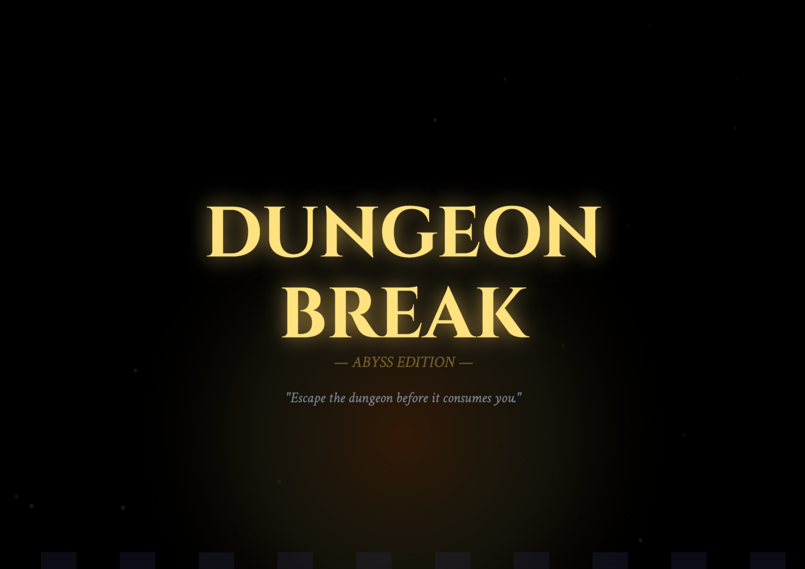
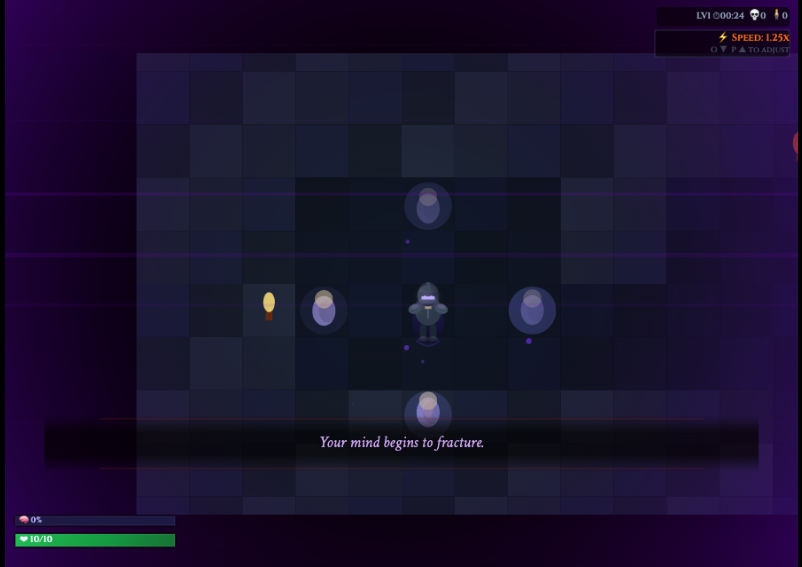
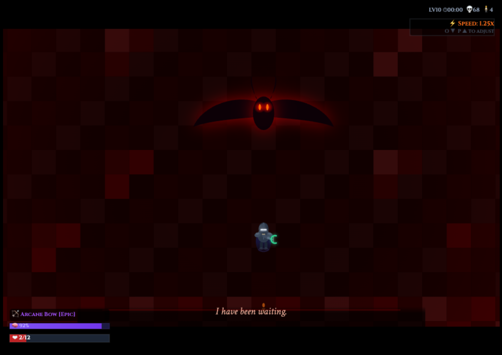

# Dungeon Break — Abyss Ascension Edition

<p align="center">
  <a href="https://pdineshsampathram-spec.github.io/dungeon-break-abyss/">
    
  </a>
  
  
  
</p>

<p align="center">
  <em>A dark-fantasy pixel-art dungeon crawler about survival, sanity, ancient trials, and the choices waiting at the bottom of the Abyss.</em>
</p>

<p align="center">
  <strong><a href="https://pdineshsampathram-spec.github.io/dungeon-break-abyss/">▶ Play the live build</a></strong>
  ·
  <strong><a href="https://github.com/pdineshsampathram-spec/dungeon-break-abyss">Source repository</a></strong>
</p>

---

## Screenshots

> **Release checklist:** Replace the current images below with fresh screenshots from the final build before announcing the release. Capture the game canvas cleanly, without browser chrome, DevTools, debug overlays, automation banners, or test-only UI.

| Main menu | Dungeon gameplay |
|---|---|
|  |  |

| Boss encounter |
|---|
|  |

## About the game

**Dungeon Break — Abyss Ascension Edition** is a browser-based dark-fantasy dungeon crawler built around a custom Canvas 2D game loop and pixel-art presentation. Guide Rowan through a ten-floor descent, manage health and sanity, collect weapons and souls, rescue survivors, and face the trials guarding the Abyss.

The game is developed as a solo project by **Dinesh Polimera**.

## Core features

- **Ten-floor descent:** Explore dungeon environments and advance through increasingly dangerous trials.
- **Distinct weapon styles:** Sword, Axe, Dagger, Spear/Trident, and Bow archetypes, with rarity and upgrade progression where supported by the deployed build.
- **Boss encounters:** Face Gorgaroth, Malakor, and the Abyss Warden.
- **Sanity and endings:** Sanity shapes the journey. The game includes the separate Shattered Mind outcome and the Hero, Betrayal, and Rampage Warden endings.
- **Survivor rescue:** Find survivors and make rescue part of your run.
- **Codex and memory archive:** Revisit lore, bestiary entries, and memories unlocked through play.
- **Achievements and speedrunning:** Earn persistent deeds and pursue floor/run time records.
- **Responsive controls:** Keyboard input on desktop and touch controls on supported mobile layouts.
- **Custom pixel-art UI:** Abyss-stone, forged-metal, violet, cyan, and ember-gold visual styling.

> **Version note:** The hosted GitHub Pages build may differ from the newest Antigravity development build. Only describe features that have been verified in the release actually being published.

## Controls

### Desktop
Open the in-game **Survival Guide** for the authoritative keyboard mapping of the deployed version.

### Mobile
Use the on-screen D-pad and gameplay action buttons. Available actions depend on the active weapon and the deployed build. The in-game Survival Guide explains the current touch controls.

## Technology

- HTML5 Canvas 2D
- JavaScript
- Custom game loop and rendering systems
- Procedural dungeon systems
- Browser-based save/progression storage

## Run locally

This repository contains a browser build. To preview it locally, serve the folder over HTTP rather than relying on direct-file loading if browser restrictions interfere with resources.

```bash
python3 -m http.server 8080
```

Then open <http://localhost:8080>.

## Developer

**Dinesh Polimera** — solo game developer.

- GitHub: [@pdineshsampathram-spec](https://github.com/pdineshsampathram-spec)
- Repository: [dungeon-break-abyss](https://github.com/pdineshsampathram-spec/dungeon-break-abyss)
- Live game: [Play Dungeon Break](https://pdineshsampathram-spec.github.io/dungeon-break-abyss/)

---

If you enjoy the game, consider starring the repository ⭐
